<p align="center">
  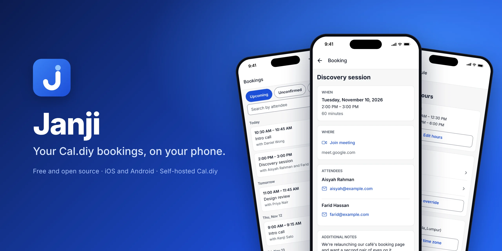
</p>

# Janji

**Janji** is a free, open-source iOS and Android app for people who run their own
[Cal.diy](https://github.com/calcom/cal.diy) scheduling server. Enter your server's address, sign in with an API
key, and handle your bookings, event types and availability from your phone, with a notification whenever someone
books, asks you to confirm, reschedules or cancels.

"Janji" is Malay for a promise or an appointment, as in _janji temu_.

> **Status:** in testing on TestFlight. The App Store and Google Play listings come next.

Janji is an independent project. It is not made by or affiliated with Cal.com, Inc.

## Why Janji exists

Cal.diy is the MIT-licensed, self-hosted community edition of Cal.com. It has no hosted version and no phone app.
Cal.com's own app only signs in to Cal.com's cloud, so it can't reach a server you run yourself. Janji fills that
gap: it talks straight to your server's Cal API v2, with no Janji account in between.

## See it in action

<p align="center">
  <a href="docs/media/janji-demo.mp4"></a>
  <br>
  <sub>Signing in, opening a booking, confirming a request, an event type's private links and a schedule.
  <a href="docs/media/janji-demo.mp4">Watch the full video (MP4)</a>.</sub>
</p>

<table>
  <tr>
    <td align="center" width="33%">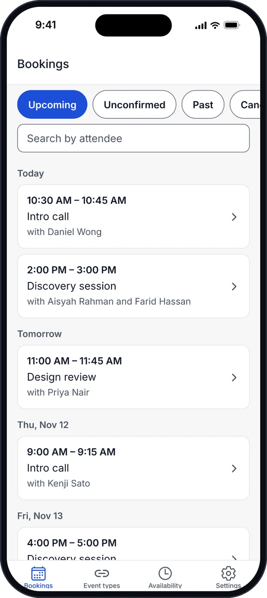<br><sub><b>Bookings</b>, grouped by day</sub></td>
    <td align="center" width="33%">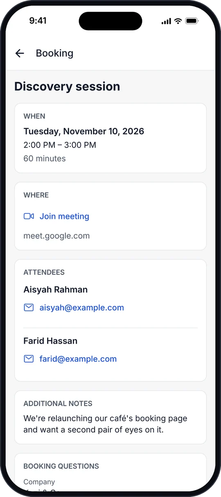<br><sub><b>A booking</b>: when, where and who</sub></td>
    <td align="center" width="33%">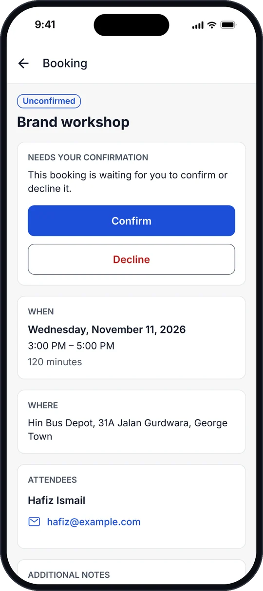<br><sub><b>Requests</b> to confirm or decline</sub></td>
  </tr>
  <tr>
    <td align="center">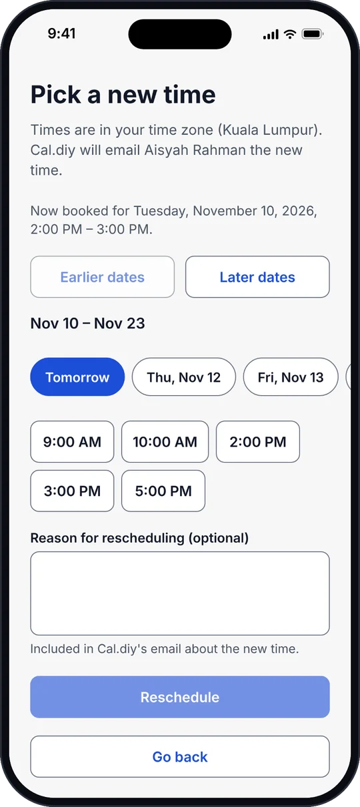<br><sub><b>Reschedule</b> to a free time</sub></td>
    <td align="center">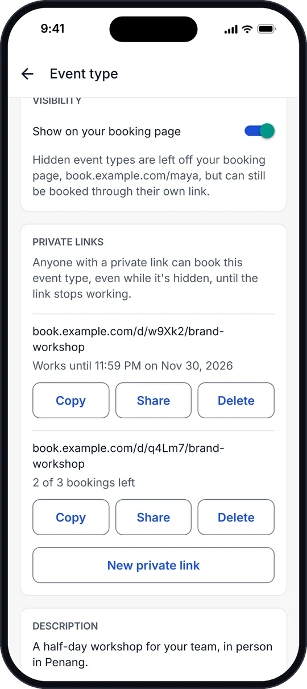<br><sub><b>Event types</b> and private links</sub></td>
    <td align="center">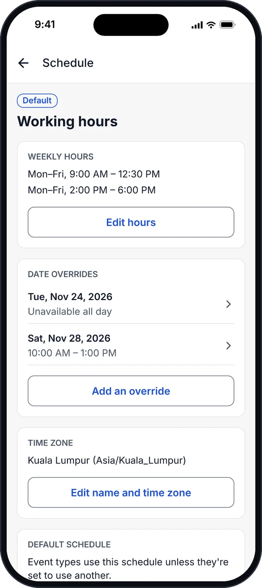<br><sub><b>Availability</b>: hours and overrides</sub></td>
  </tr>
  <tr>
    <td align="center">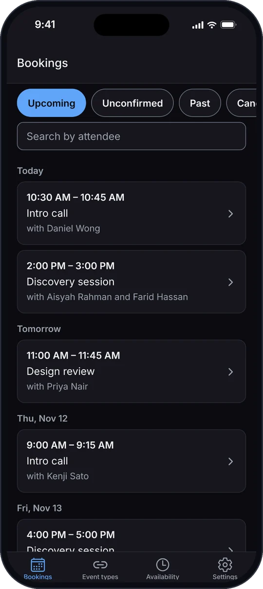<br><sub>Dark mode</sub></td>
    <td align="center">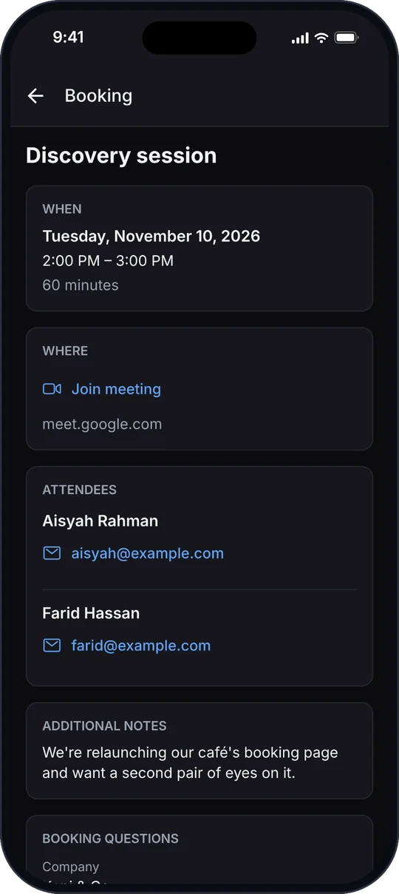<br><sub>Dark mode</sub></td>
    <td align="center">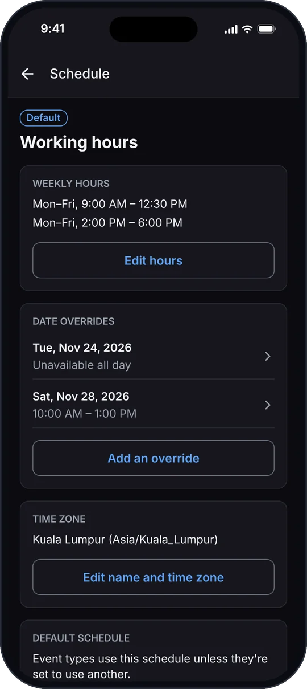<br><sub>Dark mode</sub></td>
  </tr>
</table>

<sub>The screenshots and video use a demo server with made-up people and bookings.</sub>

## Features

### Bookings

- **Every booking in one place:** upcoming, unconfirmed, past and cancelled, grouped by day, with search by
  attendee, pull to refresh and endless scrolling.
- **The whole picture:** the time in your time zone (and in your Cal.diy time zone when they differ), the meeting
  link, address or phone number, each attendee with their local time, the booker's notes, their answers to your
  booking questions, and why a booking was cancelled or rescheduled.
- **Act on it:** confirm or decline requests, cancel (including the rest of a recurring series), reschedule to a
  free time your server offers, mark no-shows, add guests, share the booking, or add it to your calendar.

### Event types

- See each event type's length, and which ones are hidden from your booking page.
- Copy or share booking links, and hide or show an event type on your booking page.
- Edit the basics: title, length, description, minimum notice and the schedule it uses.
- Make **private links** that stop working on a date or after a number of bookings, and copy, share or delete them.

### Availability

- Your schedules, with the default marked. Make new ones, rename them, change their time zone, pick the default or
  delete them.
- Edit **weekly hours**, with more than one range a day.
- Add **date overrides**: a day off, or different hours on a given day.

### Notifications

- A notification for new bookings, requests that need your confirmation, reschedules and cancellations. You choose
  which.
- Tapping one opens the booking, even when the app was closed.
- No echo: while you're in the app, a change you just made there doesn't notify you about itself.

### Everything else

- **Profile:** name, time zone, 12- or 24-hour clock and the first day of the week.
- **No Janji account:** you sign in to your own server, and the API key stays in the phone's secure storage.
- **Light and dark mode**, screen reader labels on every control, and all text ready for translation.
- **Updates without a new install:** fixes reach the app over the air with Expo Update.

## How it works

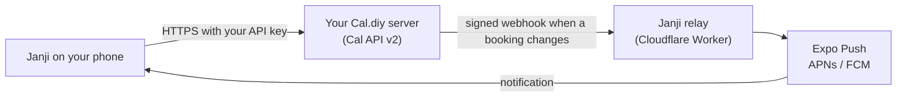

- **The app talks only to your server.** Every list and every change goes through your server's Cal API v2, the
  same API Cal.diy's own integrations use.
- **Notifications go through a small relay.** Turning them on adds one webhook to your account on your server, for
  that phone. When a booking changes, your server signs a webhook to the relay. The relay checks the signature,
  writes the notification, sends it through Expo's push service and forgets the booking. It never stores or logs
  booking details.
- **You can run your own relay** on a free Cloudflare account, and point the app at it:
  [docs/self-host-relay.md](./docs/self-host-relay.md).

What the app and the relay keep, and for how long, is in [docs/privacy.md](./docs/privacy.md).

## Get started

1. **Check that your server runs Cal API v2.** Open `https://<your-server>/api/v2/timezones` in a browser. JSON
   means it's ready. A "page not found" means API v2 isn't running yet:
   [docs/server-setup.md](./docs/server-setup.md) shows how to add it next to Cal.diy.
2. **Install Janji.** It's in testing on TestFlight now, and on its way to the App Store and Google Play. You can
   also build it yourself with [docs/release.md](./docs/release.md).
3. **Sign in.** Enter your server's address. Janji opens your server's API keys page: create a key named "Janji"
   that never expires, copy it, and paste it into the app.
4. **Turn on notifications** in Settings, if you want them.

No Cal.diy server yet? Cal.diy has no hosted version, so you run it yourself: start with
[Cal.diy's deployment guide](https://github.com/calcom/cal.diy#deployment), then
[docs/server-setup.md](./docs/server-setup.md) for Cal API v2. If your bookings are on Cal.com's cloud, use
Cal.com's own app instead.

## For developers

### Repository layout

```
apps/mobile/        Expo (React Native) app: Expo Router screens in src/app, everything else in src/
apps/relay/         push notification relay: Cloudflare Worker with D1 and KV
packages/cal-api/   typed Cal API v2 client, generated from Cal.diy's OpenAPI spec
packages/shared/    the contract the app and the relay share
docs/               server setup, privacy, support, relay hosting, releases and store text
```

### Built with

Expo SDK 58 and Expo Router · React Native · TypeScript (strict) · TanStack Query · i18next · `openapi-fetch` with
types generated from Cal.diy's OpenAPI spec · Cloudflare Workers, D1 and KV · Expo Push and Expo Update · Bun
workspaces · Biome · Jest with React Native Testing Library · Vitest with Cloudflare's Workers pool.

### Commands

You need [Bun](https://bun.sh) 1.4 or newer.

```sh
bun install          # install all workspaces
bun run mobile       # start the Expo dev server for the app
bun run check        # format and lint with Biome
bun run typecheck    # TypeScript in every workspace
bun run test         # unit tests in every workspace
```

Features that need native code, such as push notifications, run in an Expo development build rather than Expo Go.
[docs/release.md](./docs/release.md) covers development builds, store builds and over-the-air updates.

### Docs

| Guide                                           | What it covers                                         |
| ----------------------------------------------- | ------------------------------------------------------ |
| [server-setup.md](./docs/server-setup.md)       | Running Cal API v2 next to your Cal.diy server         |
| [self-host-relay.md](./docs/self-host-relay.md) | Running your own notification relay                    |
| [release.md](./docs/release.md)                 | EAS builds, store submissions and over-the-air updates |
| [privacy.md](./docs/privacy.md)                 | What the app and the relay keep                        |
| [support.md](./docs/support.md)                 | Help with common problems                              |
| [store-listing.md](./docs/store-listing.md)     | App Store and Google Play text                         |

### Contributing

Issues and pull requests are welcome. Keep pull requests small and focused, use
[Conventional Commits](https://www.conventionalcommits.org), and run `bun run check`, `bun run typecheck` and
`bun run test` before opening one.

## License

[MIT](./LICENSE). Cal.com is a trademark of Cal.com, Inc.
